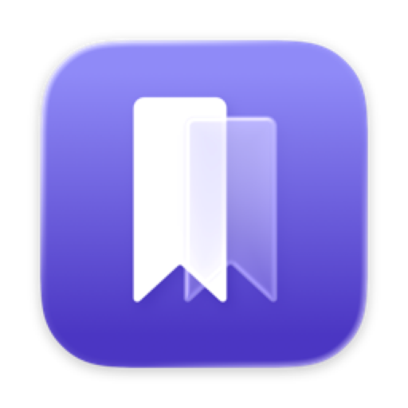
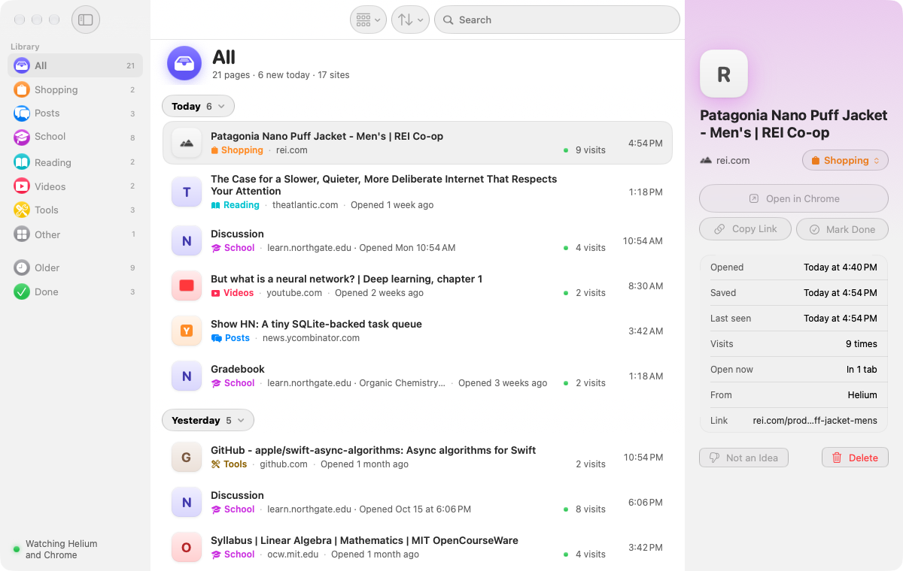
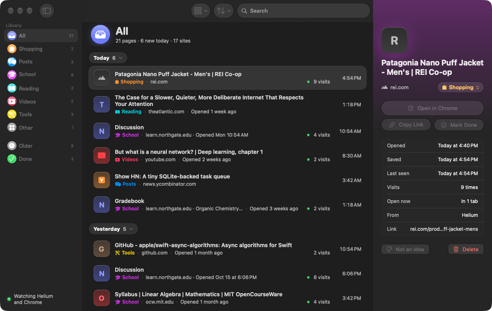

<p align="center">
  
</p>

<h1 align="center">Later</h1>

<p align="center">
  Remembers the pages you meant to come back to, quietly, and keeps them on your Mac.
</p>

<p align="center">
  
  
  
</p>

<p align="center">
  
</p>

## What it does

You open a lot of tabs. Some you read, some you mean to get back to, and some get lost when the browser restarts. Later watches your open tabs in **Helium** and **Chrome** and keeps the pages that look worth keeping. It sorts them into Shopping, Posts, School, Reading, Videos, Tools and Other, so you can find them again.

- **Nothing to set up.** No browser extension and no account.
- **Search, sort and group.** Sort by tab position, date opened, date saved, last seen, title or site.
- **Open copies and visits.** Rows show how many times you have visited a page and whether it is open now.
- **Regulars stay out of the way.** The home pages of sites you visit every few days wait in their own section instead of crowding the list.
- **Yours to correct.** Mark a page Done, move it to another kind, or tell Later a type of page is not an idea. Every change can be undone.

<p align="center">
  
</p>

## Privacy

What is on your Mac stays on your Mac. Later has **no network access at all**: its macOS sandbox has no network permission, so it cannot send anything anywhere, even by mistake. It has no accounts, analytics, crash reports or update checks.

The details, including exactly what Later reads and what it stores, are in [PRIVACY.md](PRIVACY.md).

## How it works

- **No polling.** Later does nothing on a timer. It wakes when a browser writes its session files (Helium) or when you switch to the browser (Chrome), reads the open tabs once, and goes back to sleep.
- **Official interface.** Tabs are read through each browser's own AppleScript interface, which macOS asks you to allow once per browser. Private and incognito windows are never read.
- **What gets saved.** A page is kept when you spend a while on it (about two minutes at first, then adapting to how you browse), when it stays open in the background for a minute, or when you come back to it. Search results, inboxes, sign-in providers, local addresses and one-time links (including reset, invite and sign-in links with the secret in the address) are never kept. Home feeds such as the YouTube home page are kept only if you turn that on in Settings.
- **Regulars.** A site you visit all the time (on at least 4 different days of the last 28, not counting today) is a regular. A specific page on one, like a video or an article, is still kept. Its home page and plain one-section pages are not worth remembering, so they wait in a quiet **Regulars** section below Done instead of your list, and the inspector says why in one line. **Keep Pages Like This** brings one back (and keeps pages like it from then on); **This Is a Regular** does the opposite. Both can be undone. Where Later can read the browser's history (Helium), it counts the days from it; for Chrome it counts the days a site was the page in front, as hashes, never as site names (a tab left open in the background doesn't count). A page marked Done always shows under Done, regular or not.
- **Watching runs in a small background helper.** The same app starts a windowless helper at login (it is listed in System Settings → General → Login Items). You can quit Later whenever you like and the helper keeps watching; reopen Later and its window takes over from the helper in a few milliseconds, with no page lost (a page partway through its minute starts counting again). If you would rather Later stop when you quit it, turn off **Keep watching when Later is closed** in Settings.
- **Light on resources.** The background helper uses under 10 MB of memory (7.3 MB after a day and a half) and next to no CPU while idle. The window adds to that only while Later is open.

## Requirements

- A Mac with Apple Silicon (M1 or later)
- macOS 26 or later
- Helium or Google Chrome

**Windows 11** support is in development.

## Install

1. Download `Later-1.4.0.zip` from the [Releases](../../releases) page and unzip it.
2. Drag **Later** to your Applications folder and open it.
3. macOS will say it cannot verify the app, because Later is not signed with a paid Apple Developer ID. Open **System Settings → Privacy & Security**, scroll to the message about Later, and choose **Open Anyway**. You only need to do this once.
4. Later's setup window has an **Allow…** button for each browser you have installed. Open Helium and Chrome first (it says "Open Helium first" until you do), click **Allow…**, and choose **Allow** in the macOS prompt. If you skip one, **Settings → Browsers** in Later has the same button, and Chrome is only ever asked that way. You can change this later in System Settings → Privacy & Security → Automation.

Each release includes a `.sha256` file so you can check your download: `shasum -a 256 -c Later-1.4.0.zip.sha256`.

## Build from source

You need Xcode 26 or later (or its command line tools) on an Apple Silicon Mac.

```sh
swift build
swift test
scripts/build-app.sh release   # builds, bundles and ad-hoc signs build/Later.app
```

`scripts/build-app.sh` reads an optional, git-ignored `scripts/local.env`. It can set `LATER_SIGN_IDENTITY` (a signing identity; the default is ad-hoc) and `LATER_EXTRA_HELIUM_IDS` (space-separated bundle IDs of other Helium builds to watch).

A short tour of the code is in [docs/design.md](docs/design.md).

## License

Later is **source-available**. You choose between two licenses, [PolyForm Noncommercial 1.0.0](LICENSE) and [PolyForm Small Business 1.0.0](LICENSE), and whichever one fits you applies. In plain words, you can use it, change it and share it for free:

- **For yourself.** Personal use, hobby projects and study.
- **At a school, charity, public research organization, public safety or health organization, environmental organization or government institution.**
- **At a small business:** fewer than 100 people (employees and contractors together) and less than US$1,000,000 in revenue in the previous tax year (in 2019 dollars, adjusted for inflation).

Larger companies are welcome to ask for a commercial license by [opening an issue](../../issues/new).

The [license text](LICENSE) is the only authority on the exact terms.

This is not an open-source license, so code contributions are not accepted for now. See [CONTRIBUTING.md](CONTRIBUTING.md).
